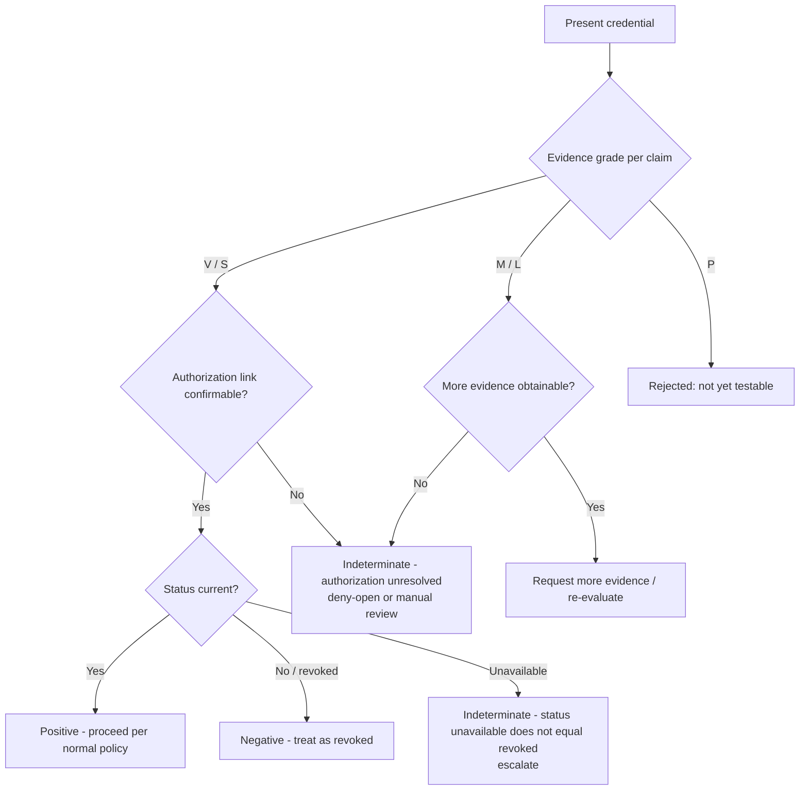
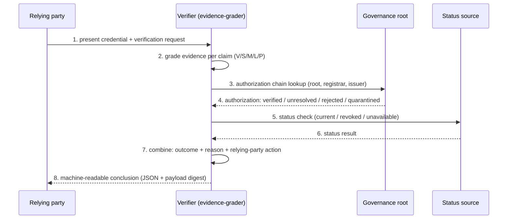

# Worked Examples — Three Implementation-Neutral Cases

Machine-readable conclusions and reproduction inputs for the three cases discussed in [FG-TIDA/use-cases#27](https://github.com/FG-TIDA/use-cases/issues/27), generated with the reference tool `tools/evidence-grader.py` (SHA-256 `E7A6FFFEB8A0B5A5D71DFA94B8E06D48A3A016633025B5E1318377A1E4EB914A`, Apache-2.0).

| Case | Input (JSON) | Outcome | Reason | Relying-party action |
|---|---|---|---|---|
| A. Valid registered credential | `caseA_valid_registered_credential_input.json` | **positive** | `none` | proceed per normal policy |
| B. Out-of-scope issuer (signature valid) | `caseB_out_of_scope_issuer_input.json` | **indeterminate** | `authorization unresolved` | do not rely on authorization; treat per risk policy (deny-open or manual review) |
| C. Status source unavailable | `caseC_unavailable_status_source_input.json` | **indeterminate** | `status unavailable ≠ revoked` | do not treat as revoked; do not treat as valid; escalate |

## Decision flow

## Verification chain

Evidence grading and authorization validity are two independent dimensions; they are graded and reported separately, never merged into a single pass/fail.

## Machine-readable notes

- Each conclusion JSON carries a `payload_digest` for end-to-end reproduction:
  - Case A: `edc9b6fafba9ccf4`
  - Case B: `995eba87beff6e7a`
  - Case C: `faaf76277c4ac390`
- Scope note: `overall_failure_class` in the conclusion JSON is computed under the tool's global discipline (out-of-scope domains report `unresolved` when no evidence is provided; this is expected v1.1 behaviour). The case-level outcome / reason / relying-party-action above is the layered interpretation discussed in FG-TIDA/use-cases#27.
- The case set is implementation-neutral: the tooling is an optional evaluation aid only; the inputs and expected outcomes are the deliverable.
- Companion diagrams: `assets/evidence_grade_vs_authority.svg` (evidence grade × authorization validity, two independent dimensions) and `assets/three_cases_outcome_flow.svg` (three-case decision flow).
