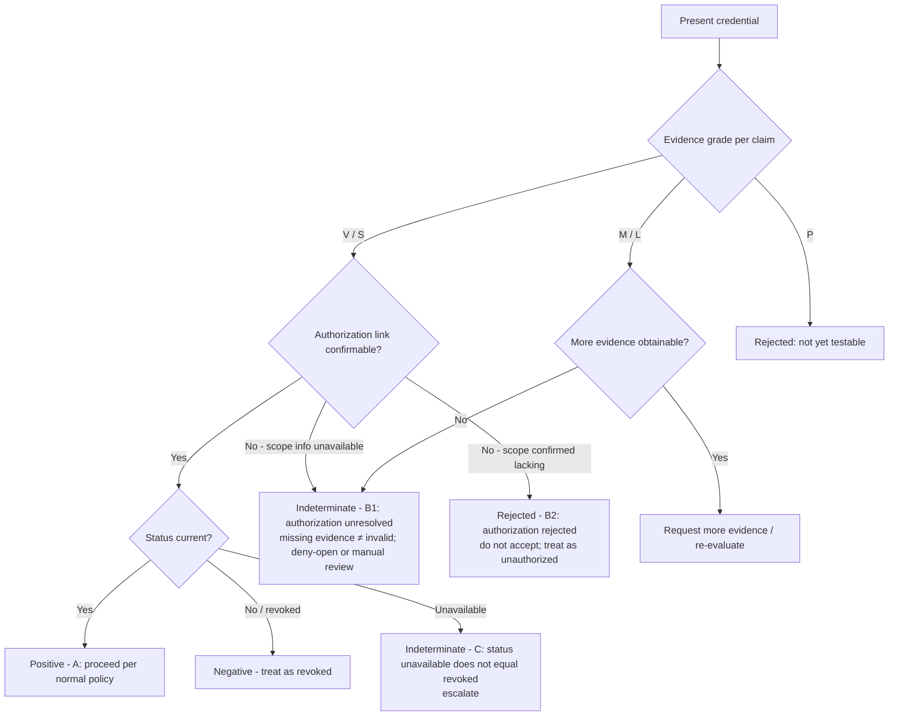
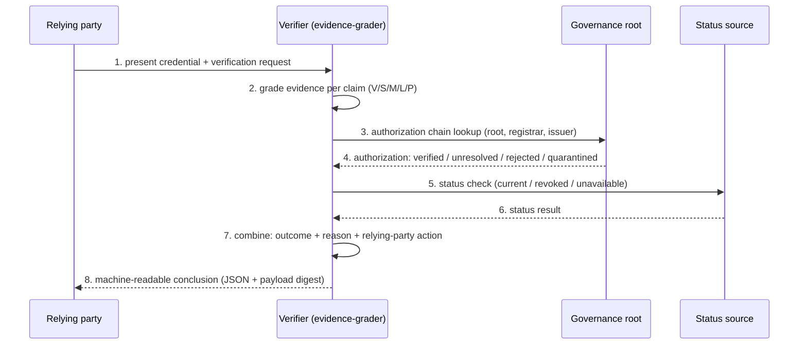

# Worked Examples — Four Implementation-Neutral Cases

Machine-readable conclusions and reproduction inputs for the cases discussed in [FG-TIDA/use-cases#27](https://github.com/FG-TIDA/use-cases/issues/27), generated with the reference tool `tools/evidence-grader.py` (v1.2, SHA-256 `98C9C1F6FABA8E1E688D0CE01FF35C3715EF51EC25072685B23A8782A1C9C91B`, Apache-2.0).

The former "Case B — Out-of-scope issuer" has been split into **B1** and **B2** per the [themes#42 review](https://github.com/FG-TIDA/themes/issues/42): missing evidence of authorization (B1, `unresolved`) must never be treated as equivalent to demonstrated invalid authorization (B2, `rejected`).

| Case | Input (JSON) | Outcome | Reason | Relying-party action |
|---|---|---|---|---|
| A. Valid registered credential | `caseA_valid_registered_credential_input.json` | **positive** | `none` | proceed per normal policy |
| B1. Unverifiable issuer scope (signature valid) | `caseB1_unverifiable_issuer_scope_input.json` | **indeterminate** | `authorization unresolved` — missing evidence of authorization ≠ demonstrated invalid authorization | do not rely on authorization; treat per risk policy (deny-open or manual review) |
| B2. Confirmed out-of-scope issuer (signature valid) | `caseB2_confirmed_out_of_scope_issuer_input.json` | **rejected** | `authorization rejected` — authoritative scope registry confirms the issuer lacks the required scope | do not accept the credential for this operation; treat as unauthorized |
| C. Status source unavailable | `caseC_unavailable_status_source_input.json` | **indeterminate** | `status unavailable ≠ revoked` | do not treat as revoked; do not treat as valid; escalate |

## B1 vs B2 — the distinction

- **B1** tests the case where authoritative issuer-scope information is **unavailable** at verification time (issuer self-declaration only). The verifier cannot confirm authorization, so the authorization result is **unresolved / indeterminate**; the relying party must not assume the issuer is out of scope, but also must not rely on the authorization.
- **B2** tests the case where an authoritative scope registry **confirms** that the issuer lacks the required scope for this credential profile and claim type, with a valid signature. The authorization result is **rejected / unauthorized**, with an explicit reason code.

Both retain explicit reason codes and remain distinguishable in the machine-readable conclusion (`authorization.result`), so implementations can fail the same observable way — addressing the interoperability concern raised in FG-TIDA themes#7 and use-cases#27 (implementations that *fail* differently break interoperability faster than implementations that *verify* differently).

## Decision flow

## Verification chain

Evidence grading and authorization validity are two independent dimensions; they are graded and reported separately, never merged into a single pass/fail.

## Machine-readable notes

- Each conclusion JSON carries a `payload_digest` for end-to-end reproduction (schema `lgd-eval/conclusion/v1.2`; the digest covers both the graded domains and the `authorization` dimension):
  - Case A: `640db270e69c9f79`
  - Case B1: `8d81c5d559914ec5`
  - Case B2: `c19e1781ebd4f690`
  - Case C: `8333b571827a1c01`
- Scope note: `overall_failure_class` in the conclusion JSON is computed under the tool's global evidence discipline (out-of-scope domains report `unresolved` when no evidence is provided; this is expected v1.x behaviour). The case-level outcome / reason / relying-party-action above is the layered interpretation discussed in FG-TIDA/use-cases#27 and themes#42 — evidence quality and authorization validity are separate axes.
- The case set is implementation-neutral: the tooling is an optional evaluation aid only; the inputs and expected outcomes are the deliverable.
- Companion diagrams: `assets/evidence_grade_vs_authority.svg` (evidence grade × authorization validity, two independent dimensions) and `assets/three_cases_outcome_flow.svg` (case decision flow, B1/B2 shown separately).
