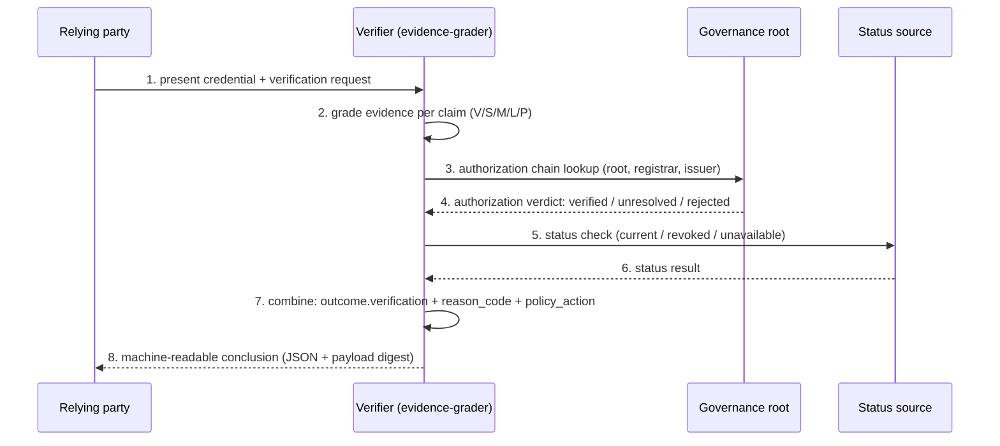

# Worked Examples — Four Implementation-Neutral Cases

Machine-readable conclusions and reproduction inputs for the cases discussed in [FG-TIDA/use-cases#27](https://github.com/FG-TIDA/use-cases/issues/27), generated with the reference tool `tools/evidence-grader.py` (v1.3, SHA-256 `74CEB2B8266478014BB5953DC63534CF68B12BC08721162A889E1E0175A7B74B`, Apache-2.0).

The former "Case B — Out-of-scope issuer" has been split into **B1** and **B2** per the [themes#42 review](https://github.com/FG-TIDA/themes/issues/42): missing evidence of authorization (B1, `unresolved`) must never be treated as equivalent to demonstrated invalid authorization (B2, `rejected`).

## One vocabulary

Earlier versions of this page, the conclusion JSON and the thread discussion used three different word sets for the same three states. As of v1.3 there is one canonical set, and it is the field to read in the machine-readable conclusion:

| Canonical (v1.3) | Field | Words used previously | Meaning |
|---|---|---|---|
| **`verified`** | `outcome.verification` | positive / valid / ALLOW | Authorization established and current |
| **`unresolved`** | `outcome.verification` | indeterminate / unverifiable / DEFER | Authorization cannot be established — *not* the same as not authorized |
| **`rejected`** | `outcome.verification` | invalid / unauthorized / DENY | Authorization affirmatively not valid — established by evidence, not inferred from absence |

Read `outcome.verification`, not `verdict` — see [Why `verdict` is not the case outcome](#why-verdict-is-not-the-case-outcome).

Policy-dependent handling is recorded **separately** from the verification outcome, in `outcome.policy_action`, using the four operator meanings already published in [EVALUATION-STANDARD.md §2.2](../../EVALUATION-STANDARD.md): `allow` / `defer` / `deny` / `exclude`. A policy action is never merged into the verification outcome, and the word `reject` is deliberately not used as an action name so that it cannot be confused with the outcome `rejected`.

## The four cases

| Case | Input (JSON) | Outcome (`outcome.verification`) | `reason_code` | `policy_action` | Relying-party action |
|---|---|---|---|---|---|
| A. Valid registered credential | `caseA_valid_registered_credential_input.json` | **verified** | `none` | `allow` | proceed per normal policy |
| B1. Unverifiable issuer scope (signature valid) | `caseB1_unverifiable_issuer_scope_input.json` | **unresolved** | `authorization_unresolved` | `defer` | do not rely on authorization; treat per risk policy (deny-open or manual review) |
| B2. Confirmed out-of-scope issuer (signature valid) | `caseB2_confirmed_out_of_scope_issuer_input.json` | **rejected** | `authorization_rejected` | `deny` | do not accept the credential for this operation; treat as unauthorized |
| C. Status source unavailable | `caseC_unavailable_status_source_input.json` | **unresolved** | `status_unavailable` | `defer` | do not treat as revoked; do not treat as valid; escalate |

Every row above is reproduced from the input file by `tools/evidence-grader.py`; none of the columns is hand-written into the conclusion.

## B1 vs B2 — the distinction

- **B1** tests the case where authoritative issuer-scope information is **unavailable** at verification time (issuer self-declaration only). The verifier cannot confirm authorization, so the outcome is **`unresolved`**; the relying party must not assume the issuer is out of scope, but also must not rely on the authorization.
- **B2** tests the case where an authoritative scope registry **confirms** that the issuer lacks the required scope for this credential profile and claim type, with a valid signature. The outcome is **`rejected`**, with an explicit reason code.

Both retain explicit, machine-readable reason codes (`authorization_unresolved` vs `authorization_rejected`) and remain distinguishable in the conclusion, so implementations can fail the same observable way — addressing the interoperability concern raised in FG-TIDA themes#7 and use-cases#27 (implementations that *fail* differently break interoperability faster than implementations that *verify* differently).

The distinction also survives a vocabulary change: whatever word an implementation uses for "not authorized", `unresolved` must remain separable from `rejected`, because the two demand different operator responses and only one of them is evidence-based.

## Decision flow

```mermaid
flowchart TD
    A[Present credential] --> B{Evidence grade per claim}
    B -->|V / S| C{Authorization link confirmable?}
    B -->|M / L| D{More evidence obtainable?}
    B -->|P| E[evidence failure_class: rejected - not yet testable]
    C -->|Yes| F{Status current?}
    C -->|No - scope info unavailable| G[unresolved - B1: authorization_unresolved<br/>missing evidence != invalid; defer]
    C -->|No - scope confirmed lacking| G2[rejected - B2: authorization_rejected<br/>deny]
    F -->|Yes| H[verified - A: allow, per normal policy]
    F -->|No / revoked| I[rejected (revoked) - deny<br/>no case file yet]
    F -->|Unavailable| J[unresolved - C: status_unavailable<br/>defer, escalate]
    D -->|Yes| K[Request more evidence / re-evaluate]
    D -->|No| G
```

## Verification chain

Evidence grading and authorization validity are two independent dimensions; they are graded and reported separately, never merged into a single pass/fail.



## Why `verdict` is not the case outcome

A conclusion carries two different summary fields, and they answer different questions:

- `outcome.verification` — the **case-level** conclusion for the dimension under test. This is what a program should read.
- `verdict` — **six-domain evidence coverage**: how many of the six evaluation domains (D1–D6) reach grade V or S. A case set that exercises one or two domains is `Insufficient evidence` here *by construction*, even when its authorization outcome is `verified`.

Until v1.3 only `verdict` existed, so a program reading it would report Case A — a valid, current, in-registration credential — as "evidence insufficient". The field was not wrong about coverage; it was being asked the wrong question. v1.3 adds `outcome`, keeps `verdict`, and labels both through an explicit `scopes` object inside every conclusion.

`overall_failure_class` has the same character: it is the worst evidence failure class across the six domains, and an unexercised (empty) domain reports `unresolved` by design in v1.x. It is not a case outcome either.

## Machine-readable notes

- Each conclusion JSON carries a `payload_digest` (schema `lgd-eval/conclusion/v1.3`). The digest covers `domains`, `authorization` and `outcome`; it does not cover `timestamp`, so the same input reproduces the same digest on any day:
  - Case A: `fa8b1420cca29307`
  - Case B1: `a353ad64f911030a`
  - Case B2: `d709c4ec85ef5d6e`
  - Case C: `982c390107058485`
- Digest convention, unchanged in wording but now actually implemented (see change 3 below): `sha256(json.dumps(obj, sort_keys=True, separators=(",", ":"), ensure_ascii=False))[:16]`, per [EVALUATION-STANDARD.md §2.3](../../EVALUATION-STANDARD.md).
- The case set is implementation-neutral: the tooling is an optional evaluation aid only; the inputs and expected outcomes are the deliverable.
- Companion diagrams: `assets/evidence_grade_vs_authority.svg` (evidence grade × authorization validity, two independent dimensions) and `assets/three_cases_outcome_flow.svg` (case decision flow, B1/B2 shown separately; the file name predates the split and is kept so existing links do not break).

## Change log — v1.2 → v1.3 (2026-10-23)

All four digests changed. There are exactly three reasons, each independently checkable against the two tagged versions:

1. **`authorization` gained two machine-readable fields**, `reason_code` and `policy_action`. Previously the reason was free prose only, and the relying-party action was free text, so neither could be compared across implementations.
2. **`outcome` was added and joined the digest.** A case-level conclusion now exists as a first-class field instead of being reconstructed by the reader from `authorization.result`.
3. **The digest is now computed the way the standard already said it should be.** `EVALUATION-STANDARD.md §2.3` specifies `sort_keys=True` with compact separators; the v1.2 implementation used default separators and insertion order. Any third party who followed §2.3 therefore could not reproduce a published digest. A test over the v1.2 files confirmed the mismatch before the change was made — under §2.3 the four v1.2 conclusions hash to `ab56339d…`, `be1677e8…`, `ff4ff95a…`, `6c37e632…`, not to the published values.

`quarantined` was removed from `authorization.result` in the same release: it describes what an operator does with an unsettled field, not what was verified, and it is now `policy_action: exclude`. Evidence-level `failure_class` still uses `quarantined` for malformed input — that is a different axis and is unchanged.
